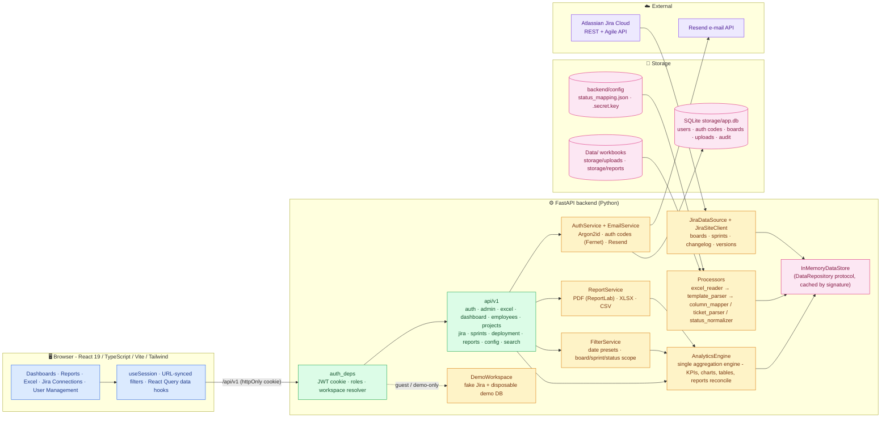
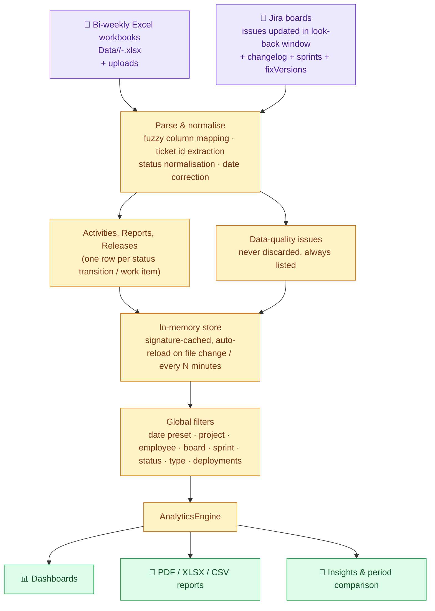
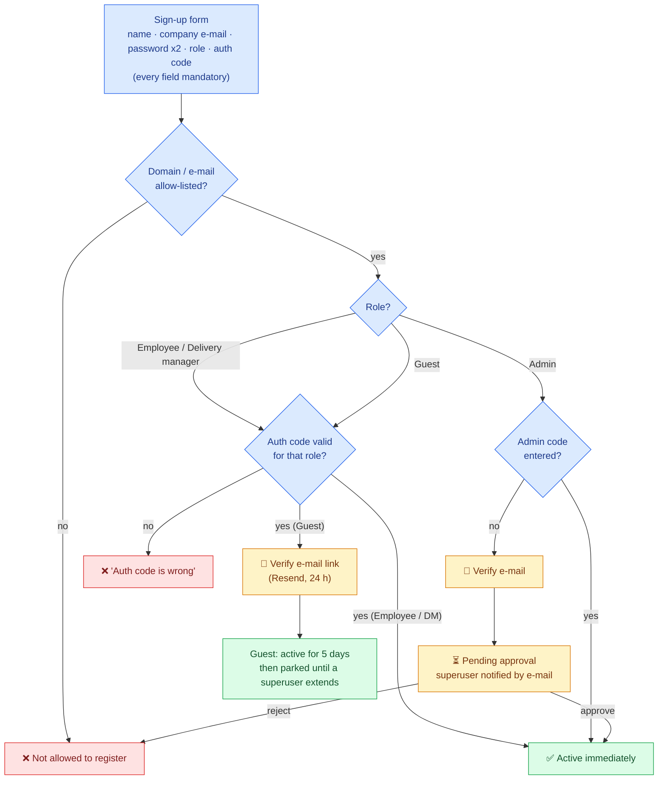
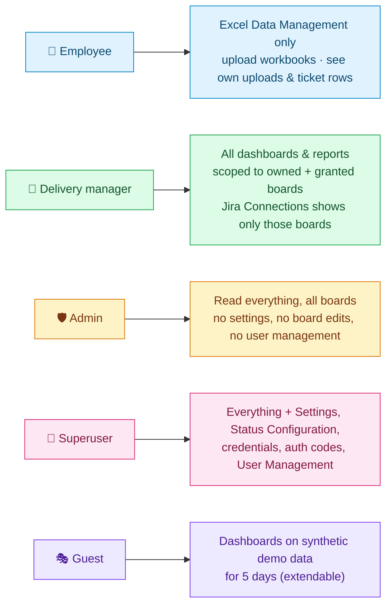

<div align="center">

# 📊 Employee Project & Delivery Performance Reporting Dashboard

**One place for employee, team, sprint and deployment performance - straight from Jira or bi-weekly Excel updates.**
No spreadsheets to stitch together, no numbers to argue about, zero manual reporting.


[Quick start](#-quick-start) ·
[Architecture](#-architecture) ·
[Data flow](#-data-flow) ·
[Security & roles](#-security-accounts-and-roles) ·
[Demo workspace](#-demo-workspace) ·
[API](#-api-reference) ·
[Configuration](#-configuration) ·
[Development](#-development)

</div>

---

## ✨ What it does

| | Capability | Details |
|---|---|---|
| 🏢 | **Executive dashboard** | Delivery position across every team: KPIs, status mix, dev/prod deployments, deltas vs the previous period |
| 👤 | **Employee performance** | Assigned / carried-over / new / completed / avg days to complete, week-by-week timeline, fair comparison against team average |
| 👥 | **Team & project analytics** | Project roll-ups, application breakdowns, workload distribution, blockers and stale work |
| 🏃 | **Sprint performance** | Active and previous sprints per Scrum board, velocity, carry-over, people and releases, sprint used as a global filter |
| 🎫 | **Jira analytics** | Unique-ticket counting, configurable status normalisation, live Jira vs Excel reconciliation |
| 🚀 | **Dev & production tracking** | Independent Dev-deployment and Production-release dimensions, release calendar, trends |
| 🧠 | **Management insights** | Rule-based insights flag overload, blockers, overdue and stale work on every page |
| 🔍 | **Data quality** | Every anomaly (missing ids, blank statuses, invalid dates, unmapped statuses) is surfaced, never silently dropped |
| 📄 | **Reports** | PDF / Excel / CSV: all employees, one employee, team, project, management summary |
| 🔐 | **Secure access** | Sign-up with role auth codes, e-mail verification, superuser approval, encrypted secrets, role-scoped data |
| 🎭 | **Demo workspace** | Synthetic 10-board / 60-people / 2,500-ticket dataset for guests, stakeholder demos and training |

---

## 🚀 Quick start

> Prerequisites: **Python 3.10+**, **Node.js 18+** (npm). Windows 10/11 and Linux are supported.

```bash
# 1. one-time: dependencies
python -m pip install -r backend/requirements.txt
cd frontend && npm install && cd ..

# 2. one-time: database + first admin
python manage.py migrate             # creates / upgrades the SQLite schema (Alembic)
python manage.py create-superuser    # prompts for e-mail + password

# 3. every time
python run.py
```

`run.py` checks prerequisites, starts the FastAPI backend and the Vite frontend, prints the URLs and shuts both down on **Ctrl+C**.
Flags: `--install` (install missing deps), `--check` (verify only), `--backend` / `--frontend` (one side), `--reload` (backend auto-reload).

| Service | URL |
|---|---|
| 🖥️ Frontend | http://localhost:5173 |
| ⚙️ Backend | http://127.0.0.1:8000 |
| 📘 API docs (Swagger) | http://127.0.0.1:8000/docs |

Then sign in, open **Jira Connections**, paste a board link, test and add - the dashboards fill themselves.
Optional configuration: copy `.env.example` to `.env` (all variables are prefixed `EDD_`, see [Configuration](#-configuration)).

---

## 🏗️ Architecture



**Design principles**

* 🧮 **One engine, one truth** - every KPI, chart, table and report is computed by `AnalyticsEngine`, so numbers always reconcile.
* 🔌 **Pluggable sources** - Excel workbooks, live Jira boards, or both; the store is repository-shaped and cached by a data signature.
* 🛡️ **Workspace isolation** - every request resolves to a *workspace* (real container or `DemoWorkspace`); guests and demo-only accounts can never reach real data.
* 📡 **Event bus** - `data.loaded` invalidates caches, config changes re-normalise statuses, uploads trigger Jira reconciliation.
* 🔒 **Secrets never leave the server** - Jira tokens and auth codes are Fernet-encrypted, passwords are Argon2id hashes.

### Repository layout

```
run.py                     single-command launcher (backend + frontend)
manage.py                  migrate · create-superuser · create-demo-superuser · create-demo-dm · db-status · allow-domain/email
backend/
  app/core/                config (pydantic-settings), security (Argon2id, JWT, Fernet), logging, exceptions
  app/db/                  SQLAlchemy models, repos, Alembic bootstrap           migrations/versions/0001..0006
  app/processors/          Excel parsing pipeline
  app/services/            analytics, filters, data store, jira client/source, reports, auth, email, demo_data, container
  app/api/                 auth_deps (roles/workspace), deps (filters), v1 routers
  tests/                   pytest suite (synthetic workbooks + in-memory DB, real data never touched)
frontend/src/
  layouts/                 sidebar + header shell (search, date range, refresh, theme, demo banner)
  hooks/                   useSession, global filters, data hooks
  components/              shadcn-style primitives, Recharts charts, TanStack DataTable, KPI cards
  modules/                 welcome · auth · executive · employees · teams · sprints · projects · jira
                           deployments · reports · excel · config · admin
Data/                      source workbooks (business data, git-ignored)
storage/                   app.db · uploads/ · reports/ · demo/ (runtime, git-ignored)
```

> 🪟 **Windows note:** `Data` and `data` are the same folder on NTFS. Runtime storage therefore lives in `storage/`, never inside `Data/`.

---

## 🔄 Data flow

### From source to dashboard



### Primary data source (`EDD_DATA_SOURCE` or Settings)

| Mode | Behaviour |
|---|---|
| `auto` *(default)* | Jira boards when credentials and at least one board exist, otherwise Excel |
| `jira` | Everything built from the configured Jira boards |
| `excel` | Bi-weekly workbooks in `Data/` plus uploads |
| `both` | Both sources combined; a ticket present in both counts once |

### How Jira maps to dashboard concepts

| Dashboard concept | Jira source |
|---|---|
| Activity (one row) | one **status transition** from the changelog, plus a snapshot on the last-updated day |
| Report | (board, assignee, day) |
| Employee | assignee (`Unassigned` when empty) |
| Project / Team | `Team` field → board project name |
| Application | primary Component → `Module` → Epic summary → first label → project name |
| Work type | issue type (Story/Improvement/Sub-task → Development, Bug/Defect → Bug fix, Test/QA → Testing, Spike → Analysis, DevOps → Deployment) |
| Work status | Jira status, normalised in **Status Configuration** |
| Dev deployment | *Jira status → Dev deployment* mapping (In Dev / In QA / In Stage / Done = deployed) |
| Production | `fixVersions` (released + date) and *In Prod* transitions; otherwise *Jira status → Production* mapping |
| Sprint | the issue's sprint(s); carried-over work is attributed to the sprint whose dates contain the day it happened |
| On-time / overdue | Jira due date, or the end of the sprint the work belongs to |

Custom field ids (Team, Sprint, Story Points, Epic, Technical Lead, Environment, Module) are resolved **by name per Atlassian site** - nothing is hard-coded.

### Excel template

```
Data/
  <EmployeeFolder>/
    <Name>-<dd-mm-yyyy>.xlsx      <- one "Bi-Weekly Delivery Status & Work Update" template per report
```

| Section | What is read |
|---|---|
| Form header | `Date`, `Jira Board`, `Team Lead`, `Team Members`, `Employee Name`, `Project / Team Name`, `Application Name` |
| Work Items & Delivery Tracking | `Application Name`, `Jira Ticket ID`, `Jira Ticket Link`, `Work Details`, `Work Type`, `Work Status`, `Production Deployment Required?`, `Dev Deployment Status`, `Additional Comments` |
| Production Deployment Summary | `Application Name`, `Production Release Tickets/Details/Date`, `Production Deployment Status` |
| Knowledge Transfer Tracking | optional KT table |
| Additional work notes | free text |

Headers are matched fuzzily (case, spaces, punctuation, synonyms such as `Jira/OS Ticket ID`). Flat sheets with a ticket-id and status column are also accepted. The backend watches `Data/` and reloads when files change.

---

## 📐 Calculation rules (also shown inside the app)

1. An **activity** is one row of a Work Items table (or one Jira status transition). Activity counts reflect reported work volume, not productivity.
2. A **unique Jira ticket** is counted once across all rows, reports and employees. Cells with several ids (`A-1, A-2`) contribute each id once.
3. Rows without a recognisable Jira id (`No Jira`, `NA`, project key only, blank) count as activities but never as tickets.
4. A ticket seen in several reports follows the **latest-status rule**: *latest report date wins* (default) or *most advanced status wins*.
5. In employee / project / application breakdowns a ticket is attributed to every group that reported it.
6. Dates come from each report's `Date` cell (falling back to the file name with day/month-swap correction).
7. `Work Status`, `Work Type`, `Dev Deployment Status`, `Production Deployment Required?` and `Production Deployment Status` are independent dimensions, never inferred from each other.
8. Unmapped values appear as **Other / Unmapped** and are never assumed complete; map them in **Status Configuration** (`backend/config/status_mapping.json`).
9. A production release row does not imply the Jira ticket is complete.

The global date filter (default **last 30 days**, inclusive) is applied server-side to every KPI, chart, table, insight and report. A sprint filter is a period of its own and overrides the date range.

---

## 🔐 Security, accounts and roles

Accounts live in SQLite (`storage/app.db`, `EDD_DATABASE_URL` to change). Passwords are **Argon2id** hashes, sessions are **httpOnly JWT cookies** (`EDD_SESSION_HOURS`, default 8), five failed sign-ins lock the account for 15 minutes, every admin action is written to an **audit log**.

### Sign-up and approval flow



* **Forgot password** → e-mailed reset link (60 min). Superusers can issue a one-time temporary password that must be changed at next sign-in; nobody can ever read an existing password.
* **Auth codes** are generated in *User Management* per role (`EMP-…`, `DM-…`, `ADMIN-…`, `GUEST-…`) with optional expiry and max uses, revocable at any time, and stored **encrypted** (Fernet) with a SHA-256 lookup hash.
* **Board codes** (`BOARD-…`) are created automatically when a delivery manager links a Jira board; the superuser hands them to other delivery managers, who redeem them in *Jira Connections* to see that board too. Grants can be revoked and codes regenerated.
* Without `EDD_RESEND_API_KEY` the verification / reset link is logged and, in `EDD_ENVIRONMENT=local`, shown in the UI as a development link.

### Roles and what they see



| Role | Dashboards | Reports | Excel upload | Jira Connections | Settings / Status config | User Management |
|---|:-:|:-:|:-:|:-:|:-:|:-:|
| Employee | - | - | own files only | - | - | - |
| Delivery manager | own + granted boards | own + granted boards | ✔ | own boards, redeem board code | - | - |
| Admin | all boards (read) | ✔ | read | read-only | read-only | - |
| Superuser | all | ✔ | ✔ | ✔ | ✔ | ✔ |
| Guest | demo data | - | - | - | - | - |

Sign-up is limited to allowed domains (`EDD_DEFAULT_ALLOWED_DOMAINS`, default `endava.com`); the superuser can add domains or individual addresses in *User Management → Registration*.

### Perimeter hardening (on by default)

* **CSRF**: every state-changing `/api` request with a cookie session must carry an `Origin`/`Referer` from an allowed origin
  (`EDD_CORS_ORIGINS`, `EDD_PUBLIC_URL` or the API host itself); browsers always send it, cross-site forms get `403`. `EDD_CSRF_PROTECTION=0` disables.
* **Rate limiting** per client IP: `EDD_RATE_LIMIT_AUTH_PER_MINUTE` (default 10) on login / sign-up / password reset / board-code redemption,
  `EDD_RATE_LIMIT_UPLOAD_PER_MINUTE` (default 6) on uploads -> `429` with `Retry-After`. In-process; put limits at the proxy for multi-node setups.
* **Security headers**: `Content-Security-Policy`, `X-Frame-Options: DENY`, `X-Content-Type-Options`, `Referrer-Policy`, `Permissions-Policy`,
  `Strict-Transport-Security` when cookies are secure; every response carries an `X-Request-ID` for log correlation.
* **Cookies** are `Secure` automatically outside `EDD_ENVIRONMENT=local` (override with `EDD_COOKIE_SECURE`).
* **Uploads** are streamed with a hard size cap and content-sniffed (`PK` zip header for .xlsx/.xlsm, OLE header for .xls).
* **Dependencies** are pinned in `backend/requirements.lock` and `frontend/package-lock.json`; CI runs `pip-audit` and `npm audit`.

### Backups, snapshots and fast restarts

```bash
python manage.py backup            # online SQLite backup -> storage/backups/app_<timestamp>.db (also nightly at EDD_BACKUP_HOUR_UTC, keeps EDD_BACKUP_KEEP)
python manage.py list-backups
python manage.py restore [file]    # stop the app first; latest backup by default, previous DB kept as *.pre-restore-*.db
```

After every successful Jira load the parsed data is written to `storage/snapshot/` and served immediately on the next start
(stale-while-revalidate: the live refresh runs in the background). Measured: data available **4 s** after process start instead of 50 s.
`/health` now reports database reachability and data-loaded state (`ok` | `degraded` | `error`).

### Moving to a new environment

```bash
python manage.py migrate            # schema is created/upgraded; legacy JSON config is imported once
python manage.py create-superuser
python run.py
```

Set `EDD_BOOTSTRAP_SUPERUSER_EMAIL` / `EDD_BOOTSTRAP_SUPERUSER_PASSWORD` in `.env` and the first superuser is created automatically
whenever the database has none (fresh environment or lost `storage/app.db`). Other commands: `db-status`, `allow-domain example.com`, `allow-email someone@partner.com`, `makemigrations -m "message"` (after editing `backend/app/db/models.py`). `EDD_AUTO_MIGRATE=1` (default) also migrates on start-up.

---

## 🎭 Demo workspace

A deterministic, in-process synthetic dataset for guests, stakeholder demos and training. It is rebuilt on every server start and is served through the **same pipeline** as real data.

| | |
|---|---|
| 🧩 Boards | **10** - 7 Scrum (Phoenix, Phoenix Mobile, Atlas Data Platform, Helios Payments, Nimbus Cloud Migration, Orion Integrations, Vega QA Automation) + 3 Kanban (Atlas Reporting, Helios Support Desk, Platform Ops) across 6 projects |
| 👥 People | **~60** with mixed international names, 5–7 per team, tech lead per team, a few people shared across teams |
| 🎫 Tickets | **~2,500** / 13,000+ activities / 77 sprints - carry-over across sprints, Blocked, On Hold, Reopened, Cancelled, unassigned, due dates, story points, releases, environments, comments, strong / overloaded / bug-heavy performer profiles |
| 👤 Accounts | **23** in every state - active, pending verification, pending approval, disabled, rejected, must-change-password, guests (3-day, 1-day, expired), 6 role codes, 10 board codes, cross-DM board grants |

```bash
python manage.py create-demo-superuser   # demo.admin@example.com   / Demo-Admin-2026!
python manage.py create-demo-dm          # demo.manager@example.com / Demo-Manager-2026!  (owns Phoenix boards, granted Vega)
```

Both demo logins are **self-healing**: the backend re-creates them on every start (`EDD_DEMO_ACCOUNTS=1`, default), so a fresh or
lost database never breaks a demo. Demo-only accounts always land in the demo workspace, see a **"Demo data"** banner, and can never reach real data. The public `/demo` page is an auto-playing 10-chapter presentation of the product.

---

## 🧪 Live Jira comparison (Excel mode)

When Excel is the source of truth, Jira acts as an **enrichment** that shows where the bi-weekly sheets and live Jira disagree.

| Check | Severity |
|---|---|
| Ticket id not found in Jira | 🔴 conflict |
| Excel status category ≠ Jira status | 🔴 conflict |
| Excel *Completed* but Jira not done / Jira *Done* but sheet still open | 🟠 warning |
| Jira assignee ≠ reporting employee, or unassigned | 🟠 warning / 🔵 info |
| Excel production pending while Jira shows released | 🟠 warning |
| Ticket project differs from the sheet's "Jira Board" | 🔵 info |
| Jira updated after the latest sheet / issue missing from every sheet | 🔵 info |
| Project without a configured board / sync error | 🔵 info (never a conflict) |

Shown in: Excel Data Management → file preview → *Compare with Jira* · Jira Analytics → *Live Jira* · Executive KPI + insight · Jira ticket dialog.
Sync runs after each data load/upload (`EDD_JIRA_AUTO_SYNC`), is cached for `EDD_JIRA_CACHE_MINUTES`, and can be forced with *Sync*.

---

## 📡 API reference

All endpoints live under `/api/v1` and are documented interactively at `/docs`. Authentication is the session cookie; role protection is enforced per router.

| Group | Endpoints | Who |
|---|---|---|
| `auth` | `options`, `signup`, `verify-email`, `login`, `logout`, `me`, `forgot-password`, `reset-password`, `change-password` | public / signed-in |
| `admin` | `users`, `users/{id}` (role, status, superuser, temp password, extend), `codes`, `boards/{id}/regenerate-code`, `users/{id}/boards`, `rules`, `audit` | superuser |
| `excel` | `status`, `refresh`, `files`, `sheets`, `preview`, `validate`, `upload`, `uploads`, `history`, `my` | role-dependent |
| `dashboard` | `executive`, `team`, `employee`, `project`, `activities`, `compare`, `data-quality` | viewers |
| `employees` / `projects` | lists, `{name}/summary`, `{name}/activities`, `{name}/performance`, `{name}/employees` | viewers |
| `sprints` | `GET /sprints`, `GET /sprints/{name}` | viewers |
| `jira` | `summary`, `status-distribution`, `tickets`, `tickets/{id}` | viewers |
| `jira/connections` | `boards`, `test`, `discover`, `me`, `redeem-code`, people picker | DM (own) / superuser |
| `jira/live` | `sync`, `status`, `reconciliation`, `reconciliation/file/{id}`, `issues/{key}`, `users`, `user-map` | viewers |
| `deployment` | `dev/summary`, `production/summary`, `trends` | viewers |
| `reports` | `types`, `generate`, `employee`, `team`, `project`, `management`, `download/{id}` | DM / admin |
| `config` | `status` (GET/PUT, `mapping`, `reset`), `app` | superuser |
| `search`, `meta` | global search, `dimensions`, `presets` | viewers |

Query parameters: `start_date`, `end_date`, `preset`, `employee`, `project`, `application`, `jira_board`, `sprint`, `status`, `work_type`, `dev_deployment`, `prod_deployment`, `prod_required`, `ticket`, `search` (list parameters may repeat).

---

## ⚙️ Configuration

Copy `.env.example` to `.env`. Everything has a sensible default.

| Area | Variables |
|---|---|
| 🌐 Server | `EDD_HOST`, `EDD_PORT`, `EDD_PUBLIC_URL`, `EDD_CORS_ORIGINS`, `EDD_ENVIRONMENT`, `EDD_LOG_LEVEL` |
| 📂 Data | `EDD_DATA_DIR`, `EDD_DATA_SOURCE`, `EDD_UPLOAD_DIR`, `EDD_MAX_UPLOAD_MB`, `EDD_DEFAULT_PERIOD_DAYS` |
| 🎫 Jira | `EDD_JIRA_EMAIL`, `EDD_JIRA_API_TOKEN`, `EDD_JIRA_EMAIL_<SITE>` / `EDD_JIRA_TOKEN_<SITE>`, `EDD_JIRA_LOOKBACK_DAYS`, `EDD_JIRA_REFRESH_MINUTES`, `EDD_JIRA_MAX_ISSUES_PER_BOARD`, `EDD_JIRA_TIMEOUT_SECONDS`, `EDD_JIRA_AUTO_SYNC`, `EDD_JIRA_CACHE_MINUTES` |
| 🔐 Auth | `EDD_DATABASE_URL`, `EDD_AUTO_MIGRATE`, `EDD_AUTH_SECRET`, `EDD_SESSION_HOURS`, `EDD_COOKIE_SECURE`, `EDD_DEFAULT_ALLOWED_DOMAINS` |
| 📧 E-mail | `EDD_RESEND_API_KEY`, `EDD_EMAIL_FROM` |
| 📄 Reports | `EDD_REPORT_DIR`, `EDD_REPORT_RETENTION` |

Credentials entered in the UI (default Jira account, per-board accounts) are stored encrypted in `backend/config/` with the key `backend/config/.secret.key` and take precedence over `.env`; `.env` changes need a restart.

---

## 🛠️ Development

```bash
# backend tests (synthetic workbooks + fresh SQLite per test; real data is never touched)
cd backend && python -m pytest -q

# frontend type-check / production build
cd frontend && npx tsc -b && npm run build

# backend with auto-reload
python run.py --reload

# new DB migration after editing backend/app/db/models.py
python manage.py makemigrations -m "describe change" && python manage.py migrate
```

**Tech stack** - Backend: FastAPI, Pydantic v2, Pandas/NumPy, openpyxl, SQLAlchemy 2 + Alembic, argon2-cffi, PyJWT, cryptography (Fernet), httpx, ReportLab, pytest.
Frontend: React 19, TypeScript, Vite, Tailwind CSS, shadcn-style components, Recharts, TanStack Table, React Router, React Query.

---

## 📌 Assumptions & limitations

* Excel work-item rows carry no individual date; they are attributed to the **report date** of their workbook.
* The team roster is derived from the data present; "no activity" means no report / transition in the period.
* A ticket reported by two employees is attributed to both, but counted once in team totals.
* Generated-report history is kept for the running session; uploads and their ticket rows are persisted per user.
* Jira loads only issues *updated* within the look-back window (default 180 days).

---

<div align="center">

**Employee Delivery Dashboard** · Internal tool for a trusted environment · Endava 2026
Designed and developed by **Suraj Shende** with guidance from **Gangadhar Ambati**

</div>
