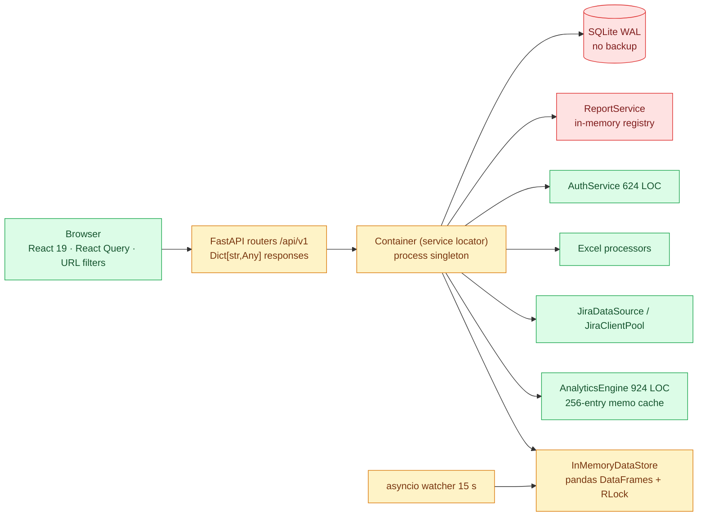
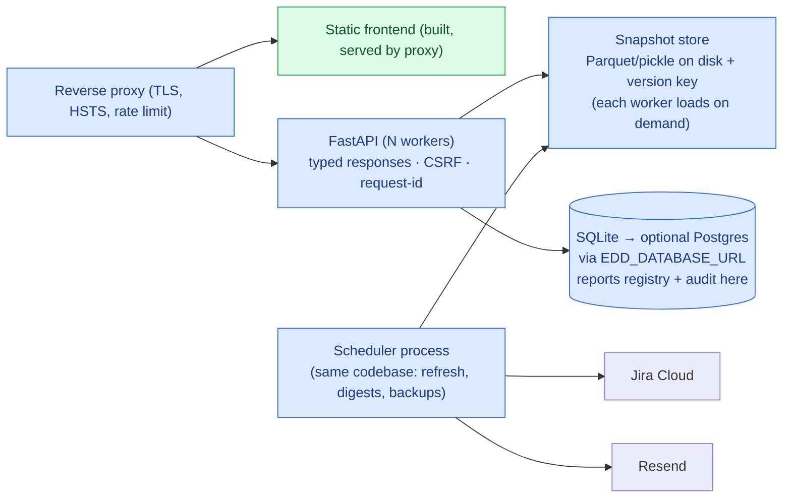
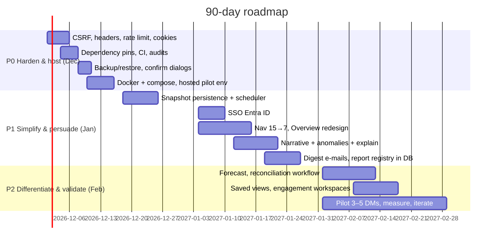

# Employee Delivery Dashboard — Strategic Product Assessment

**Date:** 28 November 2026 · **Branch audited:** `feature/adding-new-feature-market` (= `main-phase2` + merge) · **Method:** read-only code inspection (backend 10,677 LOC, frontend 9,867 LOC), live measurements against the running instance (real: 3 boards / 1,682 reports; demo: 10 boards / 7,454 reports), and web research with dated sources. No code was changed.

> **Legend.** 📏 = measured evidence · 🔍 = inspected in code (file:line) · 🧠 = expert judgement · 🌐 = external source (dated)

---

## Executive summary (read this if nothing else)

**Verdict: this is a genuinely useful internal tool with one defensible differentiator, not yet an enterprise product.**

* The problem is real and under-served: delivery managers in IT-services engagements need per-board, per-person delivery reporting reconciled against the manual status sheets clients still demand. No surveyed vendor does Excel/manual-status reconciliation or per-board role scoping (🌐 research, §B). 
* The engineering is better than its age suggests: one analytics engine, deterministic calculation rules, encrypted secrets, Argon2id, migrations, 76 tests, sub-100 ms API responses on real data (📏 §F).
* It is **not** enterprise-ready today: no CSRF protection, no rate limiting, no security headers, cookie `secure=false` by default, unpinned dependencies, single-process in-memory state, no backups, no SSO, no request tracing (🔍 §D, §I). These are P0 and fixable in 30 days.
* The product is **over-broad for its depth**: 15 navigation items, 10 KPI cards on the home page, employee data repeated on five screens, 1.4 MB of JavaScript. The next 90 days should *remove and consolidate* before adding.
* Biggest missed opportunity: the data you already compute (carry-over, blocked age, per-person completion vs team) is never turned into a **narrative** or **forecast**. Competitors ship AI summaries and Monte-Carlo forecasts; you have the cleaner data model to do it better for delivery managers.
* **Product-market fit: unproven.** One real engagement (OCS), one user-group (the author's team). Nothing here should be called PMF until 3–5 delivery managers outside the author's team use it weekly for a quarter.

**Overall score 5.6 / 10** (strong fundamentals, weak enterprise posture, unvalidated adoption). Detail in §I.

---

## A. Executive product assessment

### A1. Business problem (Phase 1)

| Question | Finding | Evidence |
|---|---|---|
| Problem solved | Fortnightly manual aggregation of per-employee status workbooks into delivery reports; lack of objective per-person / per-board delivery visibility; disagreement between what sheets say and what Jira says. | 🔍 `processors/template_parser.py` (bi-weekly template), `jira_reconcile_service.py` (sheet-vs-Jira checks), welcome page "0 hrs building reports by hand" |
| Users | Primary: delivery managers (per client board). Secondary: team leads, Endava delivery leadership (read-only admin), employees (upload only), prospects/clients (guest demo). | 🔍 `api/auth_deps.py` roles; `App.tsx:40-82` route roles |
| Primary use cases | Weekly/fortnightly client status review; sprint review; 1:1 performance conversation; production release tracking; management PDF pack. | 🔍 `report_service.py` report types; `modules/sprints`, `modules/employees` |
| Secondary | Data-quality policing of the sheets; onboarding a new board in 2 minutes; stakeholder demos. | 🔍 `dashboard/data-quality`, `modules/auth/OnboardingPage.tsx`, `demo_data.py` |
| Manual effort removed | Collecting 42 workbooks (📏 `Data/` has 42), stitching, counting unique tickets, de-duplicating statuses, writing the PDF. | 📏 README quick-start; 🧠 ~2–4 h/fortnight/DM is plausible but **unmeasured** |
| Measurable value | **None measured yet.** No baseline of hours saved, report turnaround, or decision outcomes exists. | 🧠 |
| Real problem or re-skinned Jira? | Real for three reasons that Jira dashboards cannot do: (1) unique-ticket counting across people/reports with explicit latest-status rule; (2) Excel ↔ Jira reconciliation; (3) per-board scoping with shareable board codes. Everything else (status pies, KPI tiles) *is* re-skinned Jira. | 🔍 `analytics_service.py` rules 1–9 in README §Calculation rules |
| Strongest differentiators | Services-delivery perspective; Excel-in-the-loop; board-scoped DM access; $0/seat, on-prem; demo workspace for selling. | 🌐 §B gap column |
| Weaknesses | Breadth over depth; no Git/CI signal; no forecasting/AI; enterprise security gaps; single-process architecture; no validation with external users; UI density. | §C–§F |
| Would organisations adopt it? | **Inside Endava: yes, if it is hosted centrally with SSO and someone owns it.** Outside Endava: not in current form — no multi-tenancy, no SSO, no certifications. | 🧠 |

### A2. Maturity

| Dimension | Stage | Note |
|---|---|---|
| Functionality | Late beta | Feature-complete for one engagement type; edge cases found only on OCS board |
| Engineering quality | Good for size | Layering, tests, migrations present; contracts untyped |
| Security | Pre-production | Core crypto right, perimeter controls missing |
| Operations | Developer laptop | `python run.py`, SQLite, no backup, no container |
| Adoption | Single team | 7 real accounts, 1 real engagement |
| Design | Competent template | shadcn-style, coherent tokens, but dense and repetitive |

---

## B. Global competitor benchmark (Phase 2)

Research performed 28 Nov 2026 by a research sub-agent; verified figures carry a source. Cells marked *(unverified)* are hypotheses from general knowledge, not confirmed on vendor sites.

### B1. Benchmarking matrix

| Capability | **Ours** | LinearB (US) | Swarmia (FI) | Jellyfish (US) | Plandek (UK) | eazyBI (LV) | Screenful (FI) | Rovo / Atlassian Analytics | Gap |
|---|---|---|---|---|---|---|---|---|---|
| Jira-native delivery metrics | ✅ | ✅ | ✅ | ✅ | ✅ | ✅ (DIY) | ✅ | ✅ | none |
| Per-person metrics | ✅ (workload-adjusted) | ✅ | ⚠️ team-first by design | ✅ | ⚠️ *(unverified)* | ✅ DIY | ⚠️ | ⚠️ | **we lead** |
| Sprint carry-over analysis | ✅ | ⚠️ | ⚠️ | ⚠️ | ✅ *(unverified)* | ✅ DIY | ✅ | ⚠️ | parity |
| Excel / manual-status reconciliation | ✅ | ❌ | ❌ | ❌ | ❌ | ⚠️ CSV import | ❌ | ❌ | **unique** |
| Per-board role scoping + shareable board codes | ✅ | ? | ⚠️ team | ? | ? | ⚠️ Jira perms | ⚠️ private reports | Jira perms | **unique** |
| Git / PR / CI signals (DORA) | ❌ | ✅ | ✅ | ✅ | ✅ | ⚠️ | ⚠️ | ❌ | **major gap** |
| AI narrative / Q&A | ❌ | ✅ (Enterprise) | ⚠️ | ✅ *(unverified)* | ⚠️ | ❌ | ⚠️ | ✅ Rovo | **gap** |
| Forecasting (Monte-Carlo / dates) | ❌ | ⚠️ Enterprise | ❌ | ⚠️ | ⚠️ | ❌ | ⚠️ | ❌ | gap |
| Scheduled / e-mailed reports | ❌ | ? | ? | ? | ? | ✅ | ✅ | ⚠️ | gap |
| PDF / XLSX export | ✅ | ? | ? | ? | ? | ⚠️ | ✅ | ⚠️ | parity |
| On-prem / self-hosted | ✅ | ⚠️ agents | ❌ | ? | ? | ✅ Private | ❌ (EU DC) | ❌ | **we lead** |
| SSO / SCIM | ❌ | ✅ | ✅ | ✅ | ✅ | via Jira | ✅ top tier | ✅ | **gap** |
| Multi-tenant SaaS | ❌ | ✅ | ✅ | ✅ | ✅ | ✅ | ✅ | ✅ | by design |
| Public price | $0 / seat | $29–59 /user/mo | $45–55 /dev/mo | quote (~$57k/yr median) | not public | $3 /user/mo tiers; Private $2.4k–12k/yr | $39–399 /mo flat | credits incl. in plan | **we lead** |

### B2. Compact competitor profiles

* **LinearB** — Git-workflow and PR-automation platform with DORA, AI impact, forecasting and on-prem agents on Enterprise. $29 (Essentials, GitHub Cloud only) / $59 (Enterprise) per user/month annual (🌐 linearb.io/pricing, 28 Nov 2026). *Strength:* automation, public price. *Weakness:* Git-centric, Jira secondary; ~181 people ≈ $63k–128k/yr.
* **Swarmia** — developer-first flow metrics, working agreements, Slack nudges, deliberately avoids individual leaderboards. Free ≤9 devs; $45/$55 per dev/month (🌐 busfactor.tech 15 Sep 2026, aggregator). *Weakness for us:* no individual employee view, no exec PDF focus.
* **Jellyfish** — engineering management for CFO/CTO: allocation, capitalisation, AI impact. Quote-only; Vendr median ≈ $57.5k/yr (🌐 marketintelligencetools.com 15 Oct 2026, aggregator). *Weakness:* enterprise cost; not built for engagement-level reporting.
* **Plandek (UK)** — Jira-centric delivery analytics, delivery predictability, DORA; often cited in outsourced engagements *(unverified)*. Pricing not public. **Closest conceptual competitor.**
* **DX** — owner of DX Core 4 / DXI survey index; quote-only; perception-led (🌐 busfactor.tech 4 Aug 2026).
* **Typo / Hatica (India)** — low-cost SEI: Typo $20/$28, Hatica free/$15/$29 per contributor/month (🌐 G2, Apr/Jul 2026). Git-led, sprint insights, burnout tracking.
* **eazyBI** — BI inside Jira; $3/user/mo tiers, Private (self-hosted) $2,400–12,000/yr (🌐 eazybi.com/pricing, Nov 2026). Cheapest; can model anything; needs report-building skill; no insights/AI.
* **Screenful** — plug-and-play Jira charts, flat $39–399/mo unlimited users, PDF, scheduled reports, EU data centre (🌐 G2 Apr 2026 / Capterra Oct 2026 — figures disagree, verify).
* **Atlassian Rovo / Analytics** — AI assistant included in Cloud plans as credits (25/70/150 per user); overage $0.01/credit, metered billing reported from 3 Dec 2026 (🌐 sentra.app 16 Nov 2026, breeze.pm 11 Oct 2026, aggregators). *The native baseline anything we build is compared with.*
* **Kantata / Rocketlane (PSA)** — resourcing, utilisation, billing for services firms; Kantata ~ $45/user/mo (🌐 SelectHub 9 Nov 2026). No sprint/engineering metrics — complementary, not competing.

### B3. Design comparison (benchmarks relevant to our use case)

| Pattern | Linear / Jira (category leaders) | Power BI / Tableau | Ours |
|---|---|---|---|
| Information density | One primary question per screen; progressive disclosure | Dense but user-composed | Dense by default (10 KPI tiles + 5 sections on home) 🔍 `ExecutivePage.tsx:52-145` |
| Navigation | ≤ 7 top-level items, contextual sub-nav | Workspace/report tree | 15 flat sidebar items 🔍 `AppLayout.tsx:31-47` |
| Filters | Inline chips, saved views | Slicers, bookmarks | Global bar with 9 controls, persisted across pages 🔍 `PageHeader.tsx:143-153` |
| Empty/loading/error | Systematic skeletons | Systematic | Components exist, adoption uneven 🔍 `States.tsx` |
| Theming | Semantic tokens, dark mode | Themes | Semantic HSL tokens + dark mode ✅; 30 hard-coded hex in modules 🔍 |

### B4. 2025–26 trends that matter

* **AI impact measurement is table stakes** — LinearB AI impact dashboards, Swarmia AI module, Rovo credits. (🌐)
* **DORA 2025**: 90 % of respondents use AI; AI now correlates with higher throughput; "mirror and multiplier" (🌐 blog.google, Sept 2025).
* **DX Core 4** converging DORA/SPACE/DevEx; surveys + telemetry.
* **Pricing unbundling** into modules + AI credit meters.
* **Adoption barriers** (evidence thin): per-seat cost, developer-surveillance concern, data residency. Only LinearB (agents), eazyBI Private and Screenful (EU DC) document residency options — *our on-prem posture is a real differentiator in client-constrained engagements.*

### B5. Sources (accessed 28 Nov 2026)

linearb.io/pricing · eazybi.com/pricing/jira · eazybi.com/pricing/private · g2.com/products/screenful-screenful/pricing · capterra.com/p/139635/Screenful-for-Agile/pricing · g2.com/products/hatica/pricing · g2.com/products/typo/pricing · g2.com/products/rocketlane-corp/pricing · selecthub.com/psa-software/kantata-vs-rocketlane · busfactor.tech/blog/engineering-intelligence-pricing · busfactor.tech/blog/dx-vs-swarmia · marketintelligencetools.com/rankings/software-engineering-intelligence-platforms · sentra.app/articles/atlassian-rovo · breeze.pm/articles/rovo-pricing · blog.google/…/dora-report-2025 · services.google.com/…/2025_state_of_ai_assisted_software_development.pdf · performalise.com/blog/best-delivery-intelligence-tools-2026 (earlier session).

Not profiled (time-boxed): Waydev, Pluralsight Flow, Haystack, Faros, Allstacks, Oobeya, Axify, Middleware, Keypup, Custom Charts, Great Gadgets, Nave, ActionableAgile, Tempo, BigPicture, Forecast, Productive, Scoro, Teamwork.

---

## C. Existing product audit (Phase 3)

### C1. Feature inventory

| # | Feature / screen | Route | Classification | Justification & dependencies |
|---|---|---|---|---|
| 1 | Executive Dashboard | `/` | **IMPROVE** | Core landing. Cut 10 KPI tiles → 5 primary + "more" drawer; replace repeated employee/project tables with top-N "needs attention" lists. Depends on `useExecutive`. |
| 2 | Employee Performance (list) | `/employees` | **KEEP / IMPROVE** | The differentiator (workload-adjusted, carry-over). Add saved views; make it the single employee table (see MERGE items). |
| 3 | Employee detail | `/employees/:name` | **KEEP** | 1:1 conversation page. Add "narrative summary" (§G). |
| 4 | Team Performance | `/team` | **MERGE → Projects** | Team = project in Jira mode (`Team` field → board project). Two screens answer "how is this group doing". 446–827 KB payload 📏. Merge as a tab of Project Analytics. |
| 5 | Sprint Performance | `/sprints` | **KEEP / IMPROVE** | Unique sprint-as-filter model. Add velocity trend chart & forecast (§G). |
| 6 | Project Analytics (+detail) | `/projects` | **KEEP** (absorbs Team) | |
| 7 | Jira Analytics | `/jira` | **MERGE → Executive + Tickets** | Ticket/status KPIs duplicate executive; *Live Jira* tab is the valuable part → move to Excel page ("Reconciliation") and ticket dialog. |
| 8 | Dev Deployment | `/deployments/dev` | **MERGE → Deployments** | One "Deployments" page with Dev / Production tabs; both pages share `DeploymentPages.tsx` already. 761–809 KB payload must be paginated 📏. |
| 9 | Production Releases | `/deployments/production` | **MERGE** (as above) | |
| 10 | Period Comparison | `/compare` | **IMPROVE** | Returns 422 without explicit params 📏; should default to "this period vs previous" and be reachable from any KPI delta. |
| 11 | Report Center | `/reports` | **IMPROVE** | Add schedule + e-mail (§G). History lost on restart 🔍 `report_service.py:142-153`. |
| 12 | Excel Data Management | `/excel` | **KEEP / IMPROVE** | 469-line module; split upload / my-uploads / reconciliation tabs. Employees' only screen — must be flawless. |
| 13 | Jira Connections | `/config/jira` | **KEEP** | 2-minute onboarding is a strength. Board code redemption lives here ✅. |
| 14 | Status Configuration | `/config/status` | **KEEP** | Required by rule 8 (unmapped never assumed). |
| 15 | Application Settings | `/settings` | **MERGE → Admin** | Single "Administration" area with tabs: Users · Access · Codes · Boards · Settings · Status mapping. |
| 16 | User Management | `/admin/users` | **KEEP** | Already tabbed; add confirm dialog on destructive actions 🔍 `UsersAdminPage.tsx:102`. |
| 17 | Welcome / Demo pages | `/welcome`, `/demo` | **KEEP** | Selling surface. Keep lightweight (separate chunks ✅). |
| 18 | Onboarding (DM) | `/onboarding` | **KEEP** | |
| 19 | Auth pages | various | **KEEP** | |
| 20 | Global search | header | **IMPROVE** | 93–314 ms 📏, pandas `str.contains` scan; fine now, index later. |
| 21 | Data-quality panel | `/dashboard/data-quality` | **KEEP / IMPROVE** | Surface as a badge on the Excel page and as a KPI, not a hidden endpoint. |
| 22 | Knowledge-transfer table parsing | parser | **REMOVE from UI scope** | Parsed but surfaced nowhere; keep parser, drop from roadmap. |
| — | Scheduled e-mail digest | — | **NEW** | §G |
| — | Narrative insights (AI/rule) | — | **NEW** | §G |
| — | Delivery forecast | — | **NEW** | §G |
| — | SSO (Entra ID) | — | **NEW (P0 for rollout)** | §I |
| — | Saved views / shareable links | — | **NEW** | URL filters exist 🔍 `useFilters.tsx`; add naming + sharing. |

### C2. Duplicate functionality (evidence)

* Employee tables/charts on **five** screens: `EmployeesPage.tsx:89-128`, `ExecutivePage.tsx:88-125`, `ProjectPages.tsx:166`, `DeploymentPages.tsx:142`, `TeamPage.tsx`.
* KPI grids on 6 pages with overlapping metrics (`ExecutivePage.tsx:52-70`, `EmployeesPage.tsx:89-93`, Jira, Projects, Deployments, Sprints).
* Three table layers: `Tables.tsx` (domain wrappers) → `DataTable.tsx` (TanStack) plus a separate `EmployeeSnapshotTable.tsx`.
* Dev vs Prod deployment pages share one module but two nav items.
* Team vs Project pages answer the same question in Jira mode.

### C3. Missing capabilities users will expect

Saved views · scheduled reports · comments/annotations on a number ("why was this red?") · export of any table to CSV · per-board targets/SLAs · notifications (Teams/e-mail) · audit of *who viewed what* (client-facing deployments) · SSO · bulk user import.

### C4. Click-cost problems

* Reaching one employee: 1 click from Executive link ✅, otherwise 2.
* Finding "why is this ticket blocked": Executive → Jira Analytics → tickets table → dialog (3–4). Should be 1 from any blocked count.
* Comparing periods: must set two ranges manually; should be one toggle on every KPI delta.

---

## D. Architecture assessment (Phase 4)

### D1. Current architecture (as built)



### D2. Strengths (keep)

1. **Single aggregation engine** — all numbers reconcile (`analytics_service.py`). This is the asset competitors with scattered SQL lack.
2. Clear layering: processors → services → API; Alembic migrations; ORM-only (no raw SQL found).
3. Crypto done right: Argon2id, Fernet secrets, hashed one-time tokens, encrypted auth codes.
4. Workspace abstraction (real vs demo) is a cheap, powerful isolation model.
5. Deterministic demo generator — rare and valuable for sales/training.

### D3. Weaknesses (evidence)

| Area | Finding | Evidence | Severity |
|---|---|---|---|
| Process-local state | DataFrames, analytics cache, report registry, watcher all live in one process → cannot run >1 uvicorn worker or 2 nodes; restart loses report history | 🔍 `data_store.py:70-85`, `report_service.py:142-153`, `main.py:24-45` | High |
| Cold start | Jira load 43 s for 3 boards; first request waits 8–10 s | 📏 `load_duration_ms=43162`, first `/excel/status` 8.4 s | High (UX) |
| Untyped contracts | 0 `response_model`; 116 `Dict[str, Any]` | 🔍 `api/v1/*` | Medium |
| God modules | analytics 924, report 673, auth 624 LOC | 🔍 | Medium |
| Service locator | 4 modules import `get_container`; 34 function-level imports (circular-import workarounds) | 🔍 `container.py:36-38,84-96`, `auth.py:99,122,154` | Medium |
| Dual config sources | JSON files + DB JSON stores still both present | 🔍 `config.py:41,51,61`, `repos.py:26-58` | Low (finish migration) |
| Unpaginated lists | tickets, releases, dimensions | 🔍 `analytics_service.py:811-826` | Medium |
| Watcher shutdown | task cancelled but not awaited | 🔍 `main.py:24-45` | Low |

### D4. Recommended architecture (no new infrastructure categories)

**Principle: keep the monolith, make it stateless where it must scale, and make Postgres optional — not mandatory.**



Concrete, incremental steps (each independently shippable):

1. **Persist the computed snapshot** (`InMemoryDataStore.replace()` → also write Parquet + signature). Workers load from disk; cold start drops from 43 s to <2 s (DataFrame read). Enables multi-worker and fast restarts.
2. **Move the Jira refresh + watcher into a scheduler entry-point** (`python manage.py scheduler`) using the existing code; API process becomes read-mostly. No Celery/Redis needed.
3. **Report registry → DB table** (`reports` with path, filters, created_by). Fixes restart loss and enables history/sharing.
4. **Typed responses**: introduce Pydantic response models for the 12 highest-traffic endpoints; generate the TS client from OpenAPI (removes hand-written `api.ts` drift).
5. **Split `analytics_service.py`** along its existing public boundaries (executive · employee · sprint · deployment · search) behind a façade — pure refactor, keep tests green.
6. **Finish config migration**: delete JSON fallbacks after one release with a one-shot import.
7. **Postgres compatibility test** in CI (SQLAlchemy already abstracts it) — needed only when two instances or >50 concurrent users appear.

*What not to do:* no microservices, no message broker, no Kubernetes until there are ≥2 tenants. Jira rate limits and 2–3 k issues per board are the bottleneck, not compute.

---

## E. UI/UX transformation (Phase 5)

### E1. What exists (measured)

* Tokens: HSL CSS variables for background/foreground/card/primary/secondary/muted/accent/destructive/border/ring/sidebar, light + dark (🔍 `index.css:6-46`, `tailwind.config.ts:5-25`). Font Inter; radius 0.6 rem. Status palette hard-coded hex in Tailwind config; **30 literal hex** in modules; arbitrary values (`max-w-[1600px]`, `text-[10px]`).
* Components: shadcn-style primitives, Recharts, TanStack table, toast, States (loading/error/empty) — adoption uneven.
* Navigation: 15 sidebar items; breadcrumbs optional and missing on home.
* Accessibility: some aria labels; date inputs without `htmlFor`; no `jsx-a11y` lint.
* Bundle: 1,389 KB JS / 61 chunks (charts 416 KB, index 339 KB, api 144 KB), CSS 66 KB 📏.

### E2. Proposed design system ("Clarity for delivery")

**Palette (HEX, WCAG AA on white unless noted)**

| Token | Hex | Use |
|---|---|---|
| `primary-600` | `#1E4FD8` | actions, links, active nav (Endava-compatible deep blue) |
| `primary-700` | `#173FB0` | hover/pressed |
| `primary-50` | `#EEF3FF` | selected row / soft backgrounds |
| `ink-900` | `#0F172A` | headings |
| `ink-700` | `#334155` | body |
| `ink-500` | `#64748B` | secondary text |
| `line-200` | `#E2E8F0` | borders |
| `surface-0` | `#FFFFFF` | cards |
| `surface-50` | `#F8FAFC` | page background |
| `success-600` | `#15803D` | completed / released |
| `warning-600` | `#B45309` | pending / on hold / due soon |
| `danger-600` | `#B91C1C` | blocked / overdue / failed |
| `info-600` | `#0E7490` | in progress |
| `neutral-500` | `#6B7280` | unmapped / unassigned |
| `accent-violet-600` | `#6D28D9` | sprint / forecast overlays only |

Dark mode: invert surfaces (`#0B1220` / `#111A2E`), keep semantic hues, raise lightness +10 %.

**Typography**: Inter (UI) + `tabular-nums` for all metrics. Scale: 12 / 13 (body-sm) / 14 (body) / 16 / 20 / 24 / 32. KPI value 28 semibold, label 12 uppercase tracking-wide.

**Spacing**: 4-pt grid; cards 16–20 px padding; section gap 24; page gutter 24/32. **Radius**: 8 (controls) / 12 (cards). **Shadow**: one level only (`0 1px 2px rgba(15,23,42,.06)`); rely on borders. **Icons**: lucide, 16/20 px, stroke 1.75.

### E3. Navigation redesign (15 → 7)

```
Overview            (Executive)
People              (Employee performance, detail)
Delivery            (Projects ▸ Team tab, Sprints)
Releases            (Dev / Production tabs)
Tickets             (Jira analytics + reconciliation + search)
Reports             (Center + schedules)
Data                (Excel uploads, Jira connections)        ← role-filtered
Administration      (Users, codes, boards, settings, status mapping)  ← superuser
```

Header: board switcher (primary context), period picker, "Compare with previous" toggle, search, user menu. Filters move into a collapsible chip row with **saved views**.

### E4. Page-level recommendations

| Page | Change |
|---|---|
| Overview | 5 KPIs (Delivered · In progress · Blocked · Carry-over % · Prod releases) each with delta + sparkline; one "Needs attention" list (blocked > 3 d, overdue, overloaded people); one status/flow chart; "Narrative" card (§G). Everything else behind links. |
| People | Single table (merge snapshot table), sticky header, inline bars, column chooser, CSV export, saved views. |
| Employee detail | Add "This fortnight in one paragraph" + "What changed since last review". |
| Sprints | Velocity trend (last 8), carry-over waterfall, forecast band. |
| Releases | Tabs; paginate (809 KB → ≤100 KB per page 📏). |
| Tickets | Ticket list with facets; blocked-age column; ticket drawer (not dialog) with reconciliation panel. |
| Reports | Templates + schedule + recipients; history persisted. |
| Data | Upload with progress and immediate "received ✓" state; reconciliation badge. |
| Administration | Keep tabbed table design; add confirm dialogs for delete/disable; audit tab. |

### E5. Component fixes

Consistent `LoadingState/ErrorState/EmptyState` on every page (lint rule); label every input (`htmlFor`); `eslint-plugin-jsx-a11y`; remove hex from modules in favour of `status-*` tokens; one table component; skeletons instead of spinners for tables; ticket drawer component; number formatting util with `tabular-nums`.

---

## F. Performance assessment (Phase 6)

### F1. Measurements (28 Nov 2026, local machine, median of 3)

| Endpoint | Real (3 boards, 1,682 reports) | Demo (10 boards, 7,454 reports) | Payload |
|---|---|---|---|
| Cold data load (Jira) | **43.2 s** | 2.2 s (in-process fake) | — |
| First `/excel/status` after start | 8.4 s | 10.1 s | — |
| `/dashboard/executive` | 14 ms | 30 ms | 78 → 171 KB |
| `/dashboard/team` | 50 ms | 134 ms | **446 → 827 KB** |
| `/deployment/dev/summary` | 77 ms | 146 ms | **762 → 810 KB** |
| `/jira/tickets` (unpaginated) | 22 ms | 50 ms | **349 → 536 KB** |
| `/employees/{name}/performance` | 63 ms | 132 ms | 118 KB |
| `/search?q=login` | 93 ms | **314 ms** | 2 KB |
| `/sprints` | 17 ms | 36 ms | 57–70 KB |
| `/dashboard/compare` (no params) | 422 | 422 | — |
| Frontend JS (gzip not measured) | 1,389 KB / 61 chunks | | charts 416 KB |
| Backend tests | 76 tests, 230 s | | |

### F2. Bottlenecks and recommendations

| # | Bottleneck | Evidence | Fix | Expected impact | How to verify |
|---|---|---|---|---|---|
| 1 | Jira cold load blocks first user 8–43 s | 📏 | Persist snapshot (D4-1); serve stale-while-revalidate | first paint < 2 s after restart | time `/excel/status` after restart |
| 2 | 400–800 KB JSON on Team / Deployments / Tickets | 📏 | Server pagination + field selection; gzip middleware (not enabled 🔍 `main.py`) | 5–10× smaller; faster render | payload size, Lighthouse TTI |
| 3 | Search = pandas substring scan, 314 ms at 13k rows | 📏 | Pre-built lowercase token column or SQLite FTS5 over snapshot | < 30 ms | timing at 50k rows |
| 4 | Analytics compute per filter key, 256-entry cache, single process | 🔍 `analytics_service.py:116-143` | fine ≤ 50 users; move to snapshot + per-worker cache | n/a now | load test 50 VU (locust) |
| 5 | 1.4 MB JS, 416 KB charts chunk | 📏 | lazy-load Recharts per page (already chunked), tree-shake lucide, drop unused chart types | −30 % | `vite build --report` |
| 6 | Test suite 230 s | 📏 | profile; parallelise with `pytest-xdist`; share container fixture | < 60 s | CI time |
| 7 | Upload reads whole body before size check | 🔍 `excel.py:186-190` | stream to temp with cap | memory safety | upload 200 MB file |
| 8 | Missing DB indexes (auth_tokens expiry, auth_codes kind+board, users role) | 🔍 | add in migration 0007 | negligible now, hygiene | EXPLAIN QUERY PLAN |

No claim above about *future* numbers is measured; the "expected impact" column is 🧠 and must be benchmarked when implemented.

---

## G. Innovation roadmap (Phases 7–8)

### G1. AI / automation evaluated honestly

| Idea | User problem | Why AI/automation | How | Data needed | Complexity | Value | Verdict |
|---|---|---|---|---|---|---|---|
| **Narrative delivery summary** ("this fortnight in 6 sentences") per board / person / sprint | DMs rewrite the same paragraph for clients every two weeks | Rule templates get 70 %; LLM polishes tone and picks what matters | Compute facts with `AnalyticsEngine` → structured JSON → LLM prompt with strict "only these facts" → cached per snapshot | already computed | Low–Med | High (hours/fortnight) | **Build (P1).** Rule-based first, LLM optional via Azure OpenAI in Endava tenant |
| **Explain this number** (click a KPI → which tickets, which people, what changed) | Trust; "why is blocked up 5?" | Not AI — deterministic drill-down | existing filters + diff vs previous | existing | Low | High | **Build (P1)** |
| **Delivery forecast** (Monte-Carlo on throughput → "80 % chance sprint scope done by…") | Clients ask "when" | statistics, not ML | daily throughput history per board; 10k simulations | ≥ 8 weeks history | Med | High, differentiating vs eazyBI/Screenful | **Build (P2)** |
| **Anomaly flags** (person's throughput drops 50 %, carry-over > 40 %, blocked age > 5 d) | Early warning | rule-based with z-scores; no ML needed | existing | Low | Med–High | **Build (P1)** — extend `InsightsPanel` |
| **Natural-language Q&A over the data** | Ad-hoc questions | LLM → filter JSON (not SQL) → engine | schema of filters | Med | Medium; novelty risk | **Later (P3)** — only after narrative proves usage |
| **Auto-reconciliation suggestions** (sheet says Done, Jira says In Review → propose correction e-mail to employee) | Chasing people | templated e-mail | reconciliation results | Low | Med | **Build (P2)** |
| **Agentic actions** (create Jira comment / move status) | — | — | write scope on Jira | High risk | Low | **Avoid** — client Jira write access is a trust problem |
| **AI code-impact metrics** | Industry trend | needs Git | Git/PR data we don't have | High | Unclear for DM audience | **Avoid for now** |

### G2. Feature list by category

**Must-have (for any rollout beyond the author's team)**
* SSO with Microsoft Entra ID (OIDC) — keep local accounts for guests/demo. Complexity Low–Med. Dependency: `EDD_PUBLIC_URL`, HTTPS.
* Scheduled e-mail digest (management PDF + narrative) per board, weekly/fortnightly. Med. Depends on scheduler process (D4-2), Resend.
* Backup/restore command + nightly job for SQLite; documented restore.
* Saved views & shareable filtered links (URL state already exists).
* Pagination/exports on all tables.

**High-value improvements**
* Navigation 15→7 and page consolidation (§E3).
* Persisted snapshot → instant restarts (D4-1).
* Typed API + generated TS client.
* Data-quality badge on uploads; employee upload "received ✓" flow polish.

**Differentiating**
* Narrative summaries; anomaly flags; "explain this number".
* Reconciliation workflow (assign, resolve, nudge) — turn checks into a to-do list, the only product doing this.
* Board codes → "engagement workspaces" (board + people + targets + client logo on PDF).

**Innovative**
* Monte-Carlo forecast with confidence bands on Sprint page and PDF.
* Client-facing read-only share link with watermark and expiry (guest model already exists).

**Future / roadmap**
* Optional Git/PR lead-time from Bitbucket/GitHub (one signal, not full DORA).
* Postgres + multi-instance; multi-tenant if sold beyond Endava.
* Teams notifications.

**Deliberately avoid**
* Agentic writes to client Jira; developer-surveillance style leaderboards (Swarmia's stance is a market signal); full DORA/AI-impact suite (LinearB/Jellyfish own it); 3D/animated dashboards (requested earlier — hurts trust and performance for this audience).

---

## H. Prioritised implementation roadmap (Phase 11-H)

> **Status update 28 Nov 2026 (same day):** all P0 items below are implemented (CSRF origin check, security headers + request ids,
> rate limiting, secure-cookie default, streamed/sniffed uploads, pinned dependencies + CI, backup/restore + nightly job, confirm dialogs,
> Dockerfile/compose). From P1: persisted data snapshot (startup 51 s ? 4 s measured), DB-backed report registry scoped per user,
> compact/paginated ticket + deployment payloads (dev summary 761 ? 325 KB), rule-based narrative + anomaly flags on Overview and
> Employee pages, missing DB indexes (migration 0007). SSO (OIDC / Entra ID) shipped later the same day. Navigation 15?7 (grouped sidebar) and the 5-KPI Overview shipped as well. Scheduled digest e-mails shipped (migration 0008, Reports page). Typed response contracts (Pydantic `response_model`, additive-safe) now cover the 13 highest-traffic endpoints. **All P0 and P1 items are complete.** P2 progress: Monte-Carlo forecast shipped (Overview, Sprint page, PDF). Saved views / share links shipped (migration 0009). Reconciliation workflow shipped (migration 0010). **All engineering items from P0?P2 are complete**; the remaining P2 item is organisational: a pilot with 3?5 delivery managers to measure hours saved.

### P0 — critical / blockers (30 days)

| Item | Why | Effort |
|---|---|---|
| CSRF protection (double-submit token or `SameSite=Strict` + origin check on state-changing routes) | 🔍 none present | 1 d |
| Security headers middleware (CSP, HSTS, X-Frame-Options, Referrer-Policy) + gzip | 🔍 `main.py` | 0.5 d |
| Rate limiting on `/auth/*`, `/excel/upload` (slowapi or proxy) | 🔍 none | 1 d |
| `cookie_secure` default on when `EDD_ENVIRONMENT != local`; streaming upload size cap | 🔍 `config.py:77`, `excel.py:186-190` | 0.5 d |
| Pin dependencies (`pip-compile` lock, `package-lock` committed) + `pip-audit`/`npm audit` in CI | 🔍 `>=` only | 1 d |
| Backup command + nightly schedule + documented restore | DB was lost once already this week | 1 d |
| Confirm dialogs on destructive admin actions | 🔍 `UsersAdminPage.tsx:102` | 0.5 d |
| GitHub Actions: pytest + tsc + build on PR | none | 0.5 d |
| Dockerfile + compose (proxy + API + scheduler) | needed for hosting | 2 d |
| Rotate exposed Jira API token | pasted in chat history | 0.1 d |

### P1 — high impact (60 days)

Persisted snapshot & scheduler split · SSO (Entra ID) · navigation consolidation (15→7) + Overview redesign · pagination/gzip on heavy endpoints · typed responses for top-12 endpoints · narrative summary (rule-based) + anomaly flags + "explain this number" · report registry in DB · scheduled e-mail digest · `jsx-a11y` + state-component consistency.

### P2 — important enhancements (90 days)

Monte-Carlo forecast · reconciliation workflow · saved views/share links · engagement workspace (board + people + targets + branding on PDF) · split analytics service · remove JSON config fallbacks · Postgres compatibility in CI · pilot with 3–5 DMs and measure hours saved.

### P3 — innovation / long-term

Natural-language Q&A · optional Git lead-time signal · client share links with watermark · multi-tenant hardening · Teams notifications.

### 30 / 60 / 90-day view



---

## I. Product scorecard

| Dimension | Score | Reasoning (📏 measured / 🔍 inspected / 🧠 judgement) |
|---|---|---|
| Business value | **7** | 🧠 Real, recurring DM pain; 🔍 unique reconciliation + scoping; but value unmeasured and single engagement. |
| Problem-solving effectiveness | **7** | 🔍 Deterministic rules, unique-ticket counting, carry-over attribution genuinely answer DM questions; no forecast/narrative yet. |
| Usability | **5** | 🔍 15 nav items, 10 KPIs, persisted filters surprising users, 2–4 clicks to root causes; strengths: 2-min board onboarding, URL filters. |
| UI/UX quality | **6** | 🔍 Coherent tokens, dark mode, shadcn primitives; 30 hard-coded hex, uneven states, no a11y lint, density. |
| Feature completeness | **6** | Broad for v1; missing SSO, schedules, saved views, exports, forecast. |
| Architecture | **6** | 🔍 Clean layering & single engine (+); process-local state, untyped contracts, god modules (−). |
| Performance | **6** | 📏 12–150 ms APIs excellent; 43 s cold load, 400–800 KB payloads, 1.4 MB JS, 314 ms search at 13k rows. |
| Security | **4** | 🔍 Argon2id/Fernet/JWT/lockout right; **no CSRF, rate limit, headers; insecure cookie default; unpinned deps; no SSO**. |
| Scalability | **4** | 🔍 Single process by design; SQLite; fine for ≤50 users on one node; nothing beyond. |
| Innovation | **4** | 🔍 Demo workspace & board codes are clever; no AI/forecast while market has both. |
| Competitive differentiation | **6** | 🌐 Unique on reconciliation, scoping, $0/seat on-prem; behind on Git, AI, SSO. |
| Enterprise readiness | **3** | 🔍 No SSO, backup, observability, container, CI, pinned deps; one DB loss already this week. |
| **Overall (mean)** | **5.6** | Strong core, weak perimeter, unproven adoption. |

---

## J. Product positioning (Phase 10) — straight answers

1. **What it should become (2–3 yrs):** *the delivery-manager cockpit for client engagements* — one page per engagement that a DM opens before every client call, with the status reconciled against what the client was told, a narrative ready to paste, and a forecast they can defend.
2. **Core identity:** "Traceable delivery truth for services engagements." Not an engineering-productivity platform.
3. **Primary customer:** Endava delivery managers (internal rollout) → then Endava as an accelerator for clients who insist on data staying on-prem.
4. **Strongest differentiator:** reconciliation of human-reported status vs Jira, scoped per engagement, at zero per-seat cost.
5. **Why choose us over LinearB/Plandek:** they measure engineering; we report delivery to a client. They cost $60–130k/yr for 181 people and ship data to a US SaaS; we cost hosting and stay inside the MSA perimeter.
6. **Sustainable advantage:** the engagement-specific workflow (reconciliation → nudge → narrative → PDF → client) and the accumulated history of promises vs delivery per client. Charts are not a moat; workflow + history are.
7. **Stop building:** more dashboards, more KPIs, 3D/animation, Git/AI-impact metrics, agentic Jira writes.
8. **Build exceptionally well:** Overview + People pages, reconciliation workflow, narrative/forecast, PDF pack, onboarding, SSO.
9. **Biggest missed opportunity:** you already compute the facts for a narrative and a forecast and show neither; and you have no pilot outside the author's team, so you do not yet know what DMs actually open.

**PMF assessment:** *not demonstrated.* Evidence: one engagement, seven accounts, author-driven requirements. Minimum bar before claiming PMF: 5 DMs, 3 engagements, 8 weeks of weekly use, measured hours saved, and at least one client who received the PDF and asked for it again.

---

## K. Security & reliability register (Phase 9) — critical first

| # | Risk | Evidence | Sev | Fix |
|---|---|---|---|---|
| 1 | No CSRF defence; `SameSite=Lax` only | 🔍 `api/v1/auth.py:54` | **Critical** | token or origin check on POST/PUT/DELETE |
| 2 | No rate limiting (login/signup/upload) | 🔍 | **High** | slowapi / proxy limits |
| 3 | No CSP/HSTS/X-Frame-Options | 🔍 `main.py` | **High** | middleware |
| 4 | `cookie_secure=False` default | 🔍 `config.py:77` | **High** | env-dependent default |
| 5 | Unpinned deps (`>=`) | 🔍 `requirements.txt` | **High** | lockfile + audit in CI |
| 6 | Upload fully buffered before size check; no content sniff | 🔍 `excel.py:186-190` | **High** | stream + cap + zip-magic check |
| 7 | No backup/restore; DB lost on 27 Nov | 📏 incident | **High** | `manage.py backup`, nightly |
| 8 | Single process; restart loses report registry | 🔍 `report_service.py:142-153` | Medium | registry → DB |
| 9 | No request-id / tracing; `/health` shallow | 🔍 `core/logging.py`, `main.py:90-93` | Medium | middleware + readiness |
| 10 | Missing indexes (auth_tokens expiry, auth_codes kind+board, users role) | 🔍 | Low | migration 0007 |
| 11 | No SSO; passwords for 181 staff | 🔍 | Medium (rollout blocker) | Entra ID OIDC |
| 12 | Jira API token exposed in chat history | 📏 | **High** | rotate now |
| ✅ | Argon2id, Fernet, hashed tokens, lockout, ORM-only, generic 500s, WAL + FK pragmas | 🔍 | — | keep |

Test coverage: 76 tests over auth, parsing, filters, Jira source/reconcile, reports, API; **not covered**: load/concurrency, migration rollback, backup/restore, browser e2e, accessibility.

---

*Prepared as a decision document. Every recommendation above that changes code should be approved individually; dependencies and breaking-change notes are given per item. Nothing in the repository was modified during this audit.*
